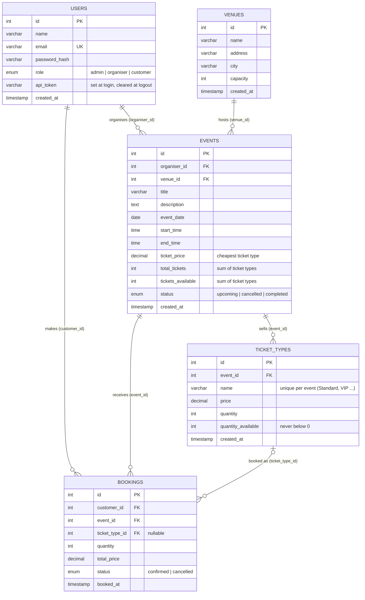

# Entity Relationship Diagram

Tables: `users`, `venues`, `events`, `ticket_types`, `bookings` (see `database.sql`). Two ways to get the diagram into draw.io.

## Option A - paste the draw.io code (recommended)

1. Open https://app.diagrams.net (draw.io) and create a **Blank Diagram**.
2. Menu **Extras > Edit Diagram...**
3. Delete everything in the box, paste the whole code block below, click **OK**.
4. The five tables and their crow's-foot relationships appear. Drag tables to rearrange; use **File > Export as** for PNG/PDF.

```xml
<mxGraphModel dx="1200" dy="800" grid="1" gridSize="10" guides="1" tooltips="1" connect="1" arrows="1" fold="1" page="1" pageScale="1" pageWidth="1169" pageHeight="827" math="0" shadow="0"><root><mxCell id="0"/><mxCell id="1" parent="0"/><mxCell id="users" value="users" style="swimlane;fontStyle=1;align=center;verticalAlign=top;childLayout=stackLayout;horizontal=1;startSize=30;horizontalStack=0;resizeParent=1;resizeParentMax=0;resizeLast=0;collapsible=0;marginBottom=0;fillColor=#0F766E;fontColor=#ffffff;strokeColor=#333333;fontSize=14;" vertex="1" parent="1"><mxGeometry x="40" y="40" width="300" height="212" as="geometry"/></mxCell><mxCell id="users_0" value="PK  id : INT" style="text;strokeColor=none;fillColor=#FFFFFF;align=left;verticalAlign=middle;spacingLeft=8;spacingRight=4;overflow=hidden;rotatable=0;fontStyle=1;fontSize=12;" vertex="1" parent="users"><mxGeometry y="30" width="300" height="26" as="geometry"/></mxCell><mxCell id="users_1" value="name : VARCHAR(100)" style="text;strokeColor=none;fillColor=#FFFFFF;align=left;verticalAlign=middle;spacingLeft=8;spacingRight=4;overflow=hidden;rotatable=0;fontSize=12;" vertex="1" parent="users"><mxGeometry y="56" width="300" height="26" as="geometry"/></mxCell><mxCell id="users_2" value="UK  email : VARCHAR(150)" style="text;strokeColor=none;fillColor=#FFFFFF;align=left;verticalAlign=middle;spacingLeft=8;spacingRight=4;overflow=hidden;rotatable=0;fontStyle=1;fontSize=12;" vertex="1" parent="users"><mxGeometry y="82" width="300" height="26" as="geometry"/></mxCell><mxCell id="users_3" value="password_hash : VARCHAR(255)" style="text;strokeColor=none;fillColor=#FFFFFF;align=left;verticalAlign=middle;spacingLeft=8;spacingRight=4;overflow=hidden;rotatable=0;fontSize=12;" vertex="1" parent="users"><mxGeometry y="108" width="300" height="26" as="geometry"/></mxCell><mxCell id="users_4" value="role : ENUM(admin, organiser, customer)" style="text;strokeColor=none;fillColor=#FFFFFF;align=left;verticalAlign=middle;spacingLeft=8;spacingRight=4;overflow=hidden;rotatable=0;fontSize=12;" vertex="1" parent="users"><mxGeometry y="134" width="300" height="26" as="geometry"/></mxCell><mxCell id="users_5" value="api_token : VARCHAR(64)" style="text;strokeColor=none;fillColor=#FFFFFF;align=left;verticalAlign=middle;spacingLeft=8;spacingRight=4;overflow=hidden;rotatable=0;fontSize=12;" vertex="1" parent="users"><mxGeometry y="160" width="300" height="26" as="geometry"/></mxCell><mxCell id="users_6" value="created_at : TIMESTAMP" style="text;strokeColor=none;fillColor=#FFFFFF;align=left;verticalAlign=middle;spacingLeft=8;spacingRight=4;overflow=hidden;rotatable=0;fontSize=12;" vertex="1" parent="users"><mxGeometry y="186" width="300" height="26" as="geometry"/></mxCell><mxCell id="venues" value="venues" style="swimlane;fontStyle=1;align=center;verticalAlign=top;childLayout=stackLayout;horizontal=1;startSize=30;horizontalStack=0;resizeParent=1;resizeParentMax=0;resizeLast=0;collapsible=0;marginBottom=0;fillColor=#B45309;fontColor=#ffffff;strokeColor=#333333;fontSize=14;" vertex="1" parent="1"><mxGeometry x="40" y="320" width="300" height="186" as="geometry"/></mxCell><mxCell id="venues_0" value="PK  id : INT" style="text;strokeColor=none;fillColor=#FFFFFF;align=left;verticalAlign=middle;spacingLeft=8;spacingRight=4;overflow=hidden;rotatable=0;fontStyle=1;fontSize=12;" vertex="1" parent="venues"><mxGeometry y="30" width="300" height="26" as="geometry"/></mxCell><mxCell id="venues_1" value="name : VARCHAR(150)" style="text;strokeColor=none;fillColor=#FFFFFF;align=left;verticalAlign=middle;spacingLeft=8;spacingRight=4;overflow=hidden;rotatable=0;fontSize=12;" vertex="1" parent="venues"><mxGeometry y="56" width="300" height="26" as="geometry"/></mxCell><mxCell id="venues_2" value="address : VARCHAR(255)" style="text;strokeColor=none;fillColor=#FFFFFF;align=left;verticalAlign=middle;spacingLeft=8;spacingRight=4;overflow=hidden;rotatable=0;fontSize=12;" vertex="1" parent="venues"><mxGeometry y="82" width="300" height="26" as="geometry"/></mxCell><mxCell id="venues_3" value="city : VARCHAR(100)" style="text;strokeColor=none;fillColor=#FFFFFF;align=left;verticalAlign=middle;spacingLeft=8;spacingRight=4;overflow=hidden;rotatable=0;fontSize=12;" vertex="1" parent="venues"><mxGeometry y="108" width="300" height="26" as="geometry"/></mxCell><mxCell id="venues_4" value="capacity : INT" style="text;strokeColor=none;fillColor=#FFFFFF;align=left;verticalAlign=middle;spacingLeft=8;spacingRight=4;overflow=hidden;rotatable=0;fontSize=12;" vertex="1" parent="venues"><mxGeometry y="134" width="300" height="26" as="geometry"/></mxCell><mxCell id="venues_5" value="created_at : TIMESTAMP" style="text;strokeColor=none;fillColor=#FFFFFF;align=left;verticalAlign=middle;spacingLeft=8;spacingRight=4;overflow=hidden;rotatable=0;fontSize=12;" vertex="1" parent="venues"><mxGeometry y="160" width="300" height="26" as="geometry"/></mxCell><mxCell id="events" value="events" style="swimlane;fontStyle=1;align=center;verticalAlign=top;childLayout=stackLayout;horizontal=1;startSize=30;horizontalStack=0;resizeParent=1;resizeParentMax=0;resizeLast=0;collapsible=0;marginBottom=0;fillColor=#1D4ED8;fontColor=#ffffff;strokeColor=#333333;fontSize=14;" vertex="1" parent="1"><mxGeometry x="400" y="40" width="300" height="368" as="geometry"/></mxCell><mxCell id="events_0" value="PK  id : INT" style="text;strokeColor=none;fillColor=#FFFFFF;align=left;verticalAlign=middle;spacingLeft=8;spacingRight=4;overflow=hidden;rotatable=0;fontStyle=1;fontSize=12;" vertex="1" parent="events"><mxGeometry y="30" width="300" height="26" as="geometry"/></mxCell><mxCell id="events_1" value="FK  organiser_id : INT" style="text;strokeColor=none;fillColor=#FFFFFF;align=left;verticalAlign=middle;spacingLeft=8;spacingRight=4;overflow=hidden;rotatable=0;fontStyle=1;fontSize=12;" vertex="1" parent="events"><mxGeometry y="56" width="300" height="26" as="geometry"/></mxCell><mxCell id="events_2" value="FK  venue_id : INT" style="text;strokeColor=none;fillColor=#FFFFFF;align=left;verticalAlign=middle;spacingLeft=8;spacingRight=4;overflow=hidden;rotatable=0;fontStyle=1;fontSize=12;" vertex="1" parent="events"><mxGeometry y="82" width="300" height="26" as="geometry"/></mxCell><mxCell id="events_3" value="title : VARCHAR(200)" style="text;strokeColor=none;fillColor=#FFFFFF;align=left;verticalAlign=middle;spacingLeft=8;spacingRight=4;overflow=hidden;rotatable=0;fontSize=12;" vertex="1" parent="events"><mxGeometry y="108" width="300" height="26" as="geometry"/></mxCell><mxCell id="events_4" value="description : TEXT" style="text;strokeColor=none;fillColor=#FFFFFF;align=left;verticalAlign=middle;spacingLeft=8;spacingRight=4;overflow=hidden;rotatable=0;fontSize=12;" vertex="1" parent="events"><mxGeometry y="134" width="300" height="26" as="geometry"/></mxCell><mxCell id="events_5" value="event_date : DATE" style="text;strokeColor=none;fillColor=#FFFFFF;align=left;verticalAlign=middle;spacingLeft=8;spacingRight=4;overflow=hidden;rotatable=0;fontSize=12;" vertex="1" parent="events"><mxGeometry y="160" width="300" height="26" as="geometry"/></mxCell><mxCell id="events_6" value="start_time : TIME" style="text;strokeColor=none;fillColor=#FFFFFF;align=left;verticalAlign=middle;spacingLeft=8;spacingRight=4;overflow=hidden;rotatable=0;fontSize=12;" vertex="1" parent="events"><mxGeometry y="186" width="300" height="26" as="geometry"/></mxCell><mxCell id="events_7" value="end_time : TIME" style="text;strokeColor=none;fillColor=#FFFFFF;align=left;verticalAlign=middle;spacingLeft=8;spacingRight=4;overflow=hidden;rotatable=0;fontSize=12;" vertex="1" parent="events"><mxGeometry y="212" width="300" height="26" as="geometry"/></mxCell><mxCell id="events_8" value="ticket_price : DECIMAL(10,2)" style="text;strokeColor=none;fillColor=#FFFFFF;align=left;verticalAlign=middle;spacingLeft=8;spacingRight=4;overflow=hidden;rotatable=0;fontSize=12;" vertex="1" parent="events"><mxGeometry y="238" width="300" height="26" as="geometry"/></mxCell><mxCell id="events_9" value="total_tickets : INT" style="text;strokeColor=none;fillColor=#FFFFFF;align=left;verticalAlign=middle;spacingLeft=8;spacingRight=4;overflow=hidden;rotatable=0;fontSize=12;" vertex="1" parent="events"><mxGeometry y="264" width="300" height="26" as="geometry"/></mxCell><mxCell id="events_10" value="tickets_available : INT" style="text;strokeColor=none;fillColor=#FFFFFF;align=left;verticalAlign=middle;spacingLeft=8;spacingRight=4;overflow=hidden;rotatable=0;fontSize=12;" vertex="1" parent="events"><mxGeometry y="290" width="300" height="26" as="geometry"/></mxCell><mxCell id="events_11" value="status : ENUM(upcoming, cancelled, completed)" style="text;strokeColor=none;fillColor=#FFFFFF;align=left;verticalAlign=middle;spacingLeft=8;spacingRight=4;overflow=hidden;rotatable=0;fontSize=12;" vertex="1" parent="events"><mxGeometry y="316" width="300" height="26" as="geometry"/></mxCell><mxCell id="events_12" value="created_at : TIMESTAMP" style="text;strokeColor=none;fillColor=#FFFFFF;align=left;verticalAlign=middle;spacingLeft=8;spacingRight=4;overflow=hidden;rotatable=0;fontSize=12;" vertex="1" parent="events"><mxGeometry y="342" width="300" height="26" as="geometry"/></mxCell><mxCell id="ticket_types" value="ticket_types" style="swimlane;fontStyle=1;align=center;verticalAlign=top;childLayout=stackLayout;horizontal=1;startSize=30;horizontalStack=0;resizeParent=1;resizeParentMax=0;resizeLast=0;collapsible=0;marginBottom=0;fillColor=#6D28D9;fontColor=#ffffff;strokeColor=#333333;fontSize=14;" vertex="1" parent="1"><mxGeometry x="780" y="40" width="300" height="212" as="geometry"/></mxCell><mxCell id="ticket_types_0" value="PK  id : INT" style="text;strokeColor=none;fillColor=#FFFFFF;align=left;verticalAlign=middle;spacingLeft=8;spacingRight=4;overflow=hidden;rotatable=0;fontStyle=1;fontSize=12;" vertex="1" parent="ticket_types"><mxGeometry y="30" width="300" height="26" as="geometry"/></mxCell><mxCell id="ticket_types_1" value="FK  event_id : INT" style="text;strokeColor=none;fillColor=#FFFFFF;align=left;verticalAlign=middle;spacingLeft=8;spacingRight=4;overflow=hidden;rotatable=0;fontStyle=1;fontSize=12;" vertex="1" parent="ticket_types"><mxGeometry y="56" width="300" height="26" as="geometry"/></mxCell><mxCell id="ticket_types_2" value="UK  name : VARCHAR(100)" style="text;strokeColor=none;fillColor=#FFFFFF;align=left;verticalAlign=middle;spacingLeft=8;spacingRight=4;overflow=hidden;rotatable=0;fontStyle=1;fontSize=12;" vertex="1" parent="ticket_types"><mxGeometry y="82" width="300" height="26" as="geometry"/></mxCell><mxCell id="ticket_types_3" value="price : DECIMAL(10,2)" style="text;strokeColor=none;fillColor=#FFFFFF;align=left;verticalAlign=middle;spacingLeft=8;spacingRight=4;overflow=hidden;rotatable=0;fontSize=12;" vertex="1" parent="ticket_types"><mxGeometry y="108" width="300" height="26" as="geometry"/></mxCell><mxCell id="ticket_types_4" value="quantity : INT" style="text;strokeColor=none;fillColor=#FFFFFF;align=left;verticalAlign=middle;spacingLeft=8;spacingRight=4;overflow=hidden;rotatable=0;fontSize=12;" vertex="1" parent="ticket_types"><mxGeometry y="134" width="300" height="26" as="geometry"/></mxCell><mxCell id="ticket_types_5" value="quantity_available : INT" style="text;strokeColor=none;fillColor=#FFFFFF;align=left;verticalAlign=middle;spacingLeft=8;spacingRight=4;overflow=hidden;rotatable=0;fontSize=12;" vertex="1" parent="ticket_types"><mxGeometry y="160" width="300" height="26" as="geometry"/></mxCell><mxCell id="ticket_types_6" value="created_at : TIMESTAMP" style="text;strokeColor=none;fillColor=#FFFFFF;align=left;verticalAlign=middle;spacingLeft=8;spacingRight=4;overflow=hidden;rotatable=0;fontSize=12;" vertex="1" parent="ticket_types"><mxGeometry y="186" width="300" height="26" as="geometry"/></mxCell><mxCell id="bookings" value="bookings" style="swimlane;fontStyle=1;align=center;verticalAlign=top;childLayout=stackLayout;horizontal=1;startSize=30;horizontalStack=0;resizeParent=1;resizeParentMax=0;resizeLast=0;collapsible=0;marginBottom=0;fillColor=#9D174D;fontColor=#ffffff;strokeColor=#333333;fontSize=14;" vertex="1" parent="1"><mxGeometry x="400" y="500" width="300" height="238" as="geometry"/></mxCell><mxCell id="bookings_0" value="PK  id : INT" style="text;strokeColor=none;fillColor=#FFFFFF;align=left;verticalAlign=middle;spacingLeft=8;spacingRight=4;overflow=hidden;rotatable=0;fontStyle=1;fontSize=12;" vertex="1" parent="bookings"><mxGeometry y="30" width="300" height="26" as="geometry"/></mxCell><mxCell id="bookings_1" value="FK  customer_id : INT" style="text;strokeColor=none;fillColor=#FFFFFF;align=left;verticalAlign=middle;spacingLeft=8;spacingRight=4;overflow=hidden;rotatable=0;fontStyle=1;fontSize=12;" vertex="1" parent="bookings"><mxGeometry y="56" width="300" height="26" as="geometry"/></mxCell><mxCell id="bookings_2" value="FK  event_id : INT" style="text;strokeColor=none;fillColor=#FFFFFF;align=left;verticalAlign=middle;spacingLeft=8;spacingRight=4;overflow=hidden;rotatable=0;fontStyle=1;fontSize=12;" vertex="1" parent="bookings"><mxGeometry y="82" width="300" height="26" as="geometry"/></mxCell><mxCell id="bookings_3" value="FK  ticket_type_id : INT (nullable)" style="text;strokeColor=none;fillColor=#FFFFFF;align=left;verticalAlign=middle;spacingLeft=8;spacingRight=4;overflow=hidden;rotatable=0;fontStyle=1;fontSize=12;" vertex="1" parent="bookings"><mxGeometry y="108" width="300" height="26" as="geometry"/></mxCell><mxCell id="bookings_4" value="quantity : INT" style="text;strokeColor=none;fillColor=#FFFFFF;align=left;verticalAlign=middle;spacingLeft=8;spacingRight=4;overflow=hidden;rotatable=0;fontSize=12;" vertex="1" parent="bookings"><mxGeometry y="134" width="300" height="26" as="geometry"/></mxCell><mxCell id="bookings_5" value="total_price : DECIMAL(10,2)" style="text;strokeColor=none;fillColor=#FFFFFF;align=left;verticalAlign=middle;spacingLeft=8;spacingRight=4;overflow=hidden;rotatable=0;fontSize=12;" vertex="1" parent="bookings"><mxGeometry y="160" width="300" height="26" as="geometry"/></mxCell><mxCell id="bookings_6" value="status : ENUM(confirmed, cancelled)" style="text;strokeColor=none;fillColor=#FFFFFF;align=left;verticalAlign=middle;spacingLeft=8;spacingRight=4;overflow=hidden;rotatable=0;fontSize=12;" vertex="1" parent="bookings"><mxGeometry y="186" width="300" height="26" as="geometry"/></mxCell><mxCell id="bookings_7" value="booked_at : TIMESTAMP" style="text;strokeColor=none;fillColor=#FFFFFF;align=left;verticalAlign=middle;spacingLeft=8;spacingRight=4;overflow=hidden;rotatable=0;fontSize=12;" vertex="1" parent="bookings"><mxGeometry y="212" width="300" height="26" as="geometry"/></mxCell><mxCell id="r1" value="organises (organiser_id)" style="edgeStyle=entityRelationEdgeStyle;fontSize=12;html=1;endArrow=ERmany;startArrow=ERmandOne;endFill=0;startFill=0;strokeWidth=2;" edge="1" parent="1" source="users" target="events"><mxGeometry relative="1" as="geometry"/></mxCell><mxCell id="r2" value="hosts (venue_id)" style="edgeStyle=entityRelationEdgeStyle;fontSize=12;html=1;endArrow=ERmany;startArrow=ERmandOne;endFill=0;startFill=0;strokeWidth=2;" edge="1" parent="1" source="venues" target="events"><mxGeometry relative="1" as="geometry"/></mxCell><mxCell id="r3" value="sells (event_id)" style="edgeStyle=entityRelationEdgeStyle;fontSize=12;html=1;endArrow=ERmany;startArrow=ERmandOne;endFill=0;startFill=0;strokeWidth=2;" edge="1" parent="1" source="events" target="ticket_types"><mxGeometry relative="1" as="geometry"/></mxCell><mxCell id="r4" value="receives (event_id)" style="edgeStyle=entityRelationEdgeStyle;fontSize=12;html=1;endArrow=ERmany;startArrow=ERmandOne;endFill=0;startFill=0;strokeWidth=2;" edge="1" parent="1" source="events" target="bookings"><mxGeometry relative="1" as="geometry"/></mxCell><mxCell id="r5" value="makes (customer_id)" style="edgeStyle=entityRelationEdgeStyle;fontSize=12;html=1;endArrow=ERmany;startArrow=ERmandOne;endFill=0;startFill=0;strokeWidth=2;" edge="1" parent="1" source="users" target="bookings"><mxGeometry relative="1" as="geometry"/></mxCell><mxCell id="r6" value="booked as (ticket_type_id)" style="edgeStyle=entityRelationEdgeStyle;fontSize=12;html=1;endArrow=ERmany;startArrow=ERmandOne;endFill=0;startFill=0;strokeWidth=2;" edge="1" parent="1" source="ticket_types" target="bookings"><mxGeometry relative="1" as="geometry"/></mxCell></root></mxGraphModel>
```

## Option B - Mermaid

In draw.io: **Arrange > Insert > Advanced > Mermaid...**, paste the block below and click **Insert**.
It also renders on GitHub, https://mermaid.live and the VS Code Mermaid preview.



## Relationships in words

| Relationship | Meaning | On delete |
|---|---|---|
| users 1 - N events | one organiser creates many events | RESTRICT (a user who owns events cannot be deleted) |
| venues 1 - N events | one venue hosts many events | RESTRICT (a venue used by events cannot be deleted) |
| events 1 - N ticket_types | an event sells one or more ticket types (Standard, VIP ...) | CASCADE (deleting an event deletes its ticket types) |
| users 1 - N bookings | one customer makes many bookings | RESTRICT |
| events 1 - N bookings | one event has many bookings | CASCADE (deleting an event deletes its bookings) |
| ticket_types 1 - N bookings | every booking is for one ticket type | SET NULL (a ticket type can only be deleted when it has no *confirmed* bookings; old cancelled bookings stay with `ticket_type_id` empty) |

## How the numbers stay consistent

`ticket_types` is the source of truth for tickets. After every change the API recalculates on the event:
`total_tickets` = sum of `quantity`, `tickets_available` = sum of `quantity_available`, `ticket_price` = cheapest ticket type.
The ticket types of one event together can never exceed the venue `capacity`.
